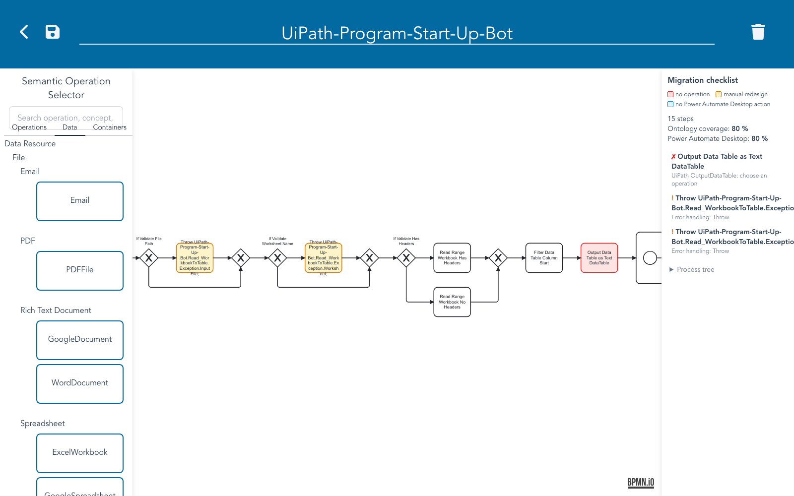
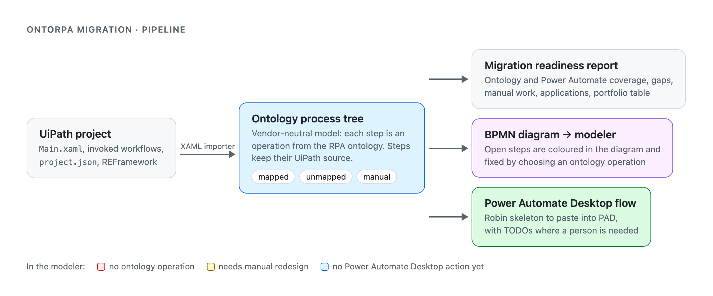
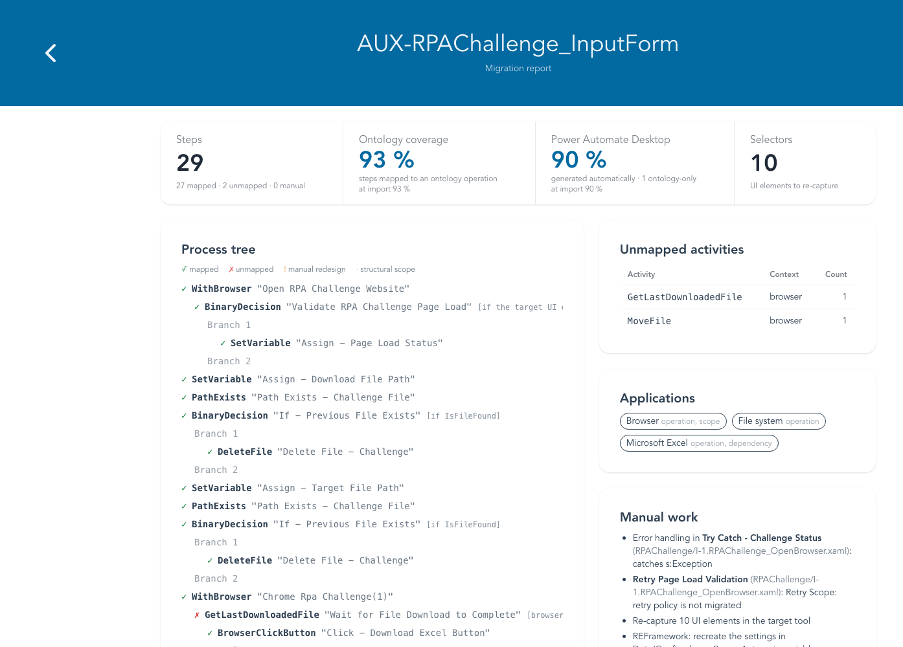

# OntoRPA Migration

**Migrating software robots from UiPath to Power Automate through a vendor-neutral ontology.** A thesis project that extends the [OntoRPA platform](https://github.com/bptlab/onto-rpa-platform) into a tool for migrating and maintaining RPA bot portfolios.



<sub>An imported UiPath bot in the modeler. Amber steps need manual redesign, and the red step has no ontology operation yet. The migration checklist lists them with the live coverage. Example bot: [UiPath-Program-Start-Up-Bot](https://github.com/ShonHarsh/UiPath-Program-Start-Up-Bot) (MIT).</sub>

## Background

Robotic process automation (RPA) bots click through user interfaces, move data between Excel, e-mail, browsers and ERP systems, and run business processes unattended. Organisations build up whole portfolios of them in one vendor's tool. When they switch platforms, for example from **UiPath** to Microsoft **Power Automate**, every bot has to be rebuilt by hand: its workflows, UI selectors, expressions, error handling and Orchestrator configuration.

Migration splits into twelve smaller problems: import, activity mapping, control flow, expressions, selectors, error handling, config and secrets, orchestration, custom code, effort estimation, inventory and equivalence. This project solves the first two end to end and makes the rest visible, so that the manual work left in a bot can be seen and estimated.

## Idea

[OntoRPA](https://github.com/bptlab/onto-rpa-platform) (Maximilian Völker, Hasso Plattner Institute) describes bots with an ontology of RPA operations, such as *open a browser*, *read an Excel range* or *send an e-mail*, independent of any vendor. This project uses that ontology as the **intermediate layer of a migration**:

- UiPath steps are translated *into* ontology operations.
- Power Automate Desktop actions are generated *from* them.

The share of steps that land on an ontology operation makes the research question measurable: *how well does an ontology work as an intermediate layer for migrating bots?* The steps that don't map become the evidence for extending the ontology.

<picture>
  <source media="(prefers-color-scheme: dark)" srcset="docs/images/pipeline-dark.png">
  
</picture>

## How it works

1. **Import.** The importer reads a UiPath project (`Main.xaml`, invoked workflows, `project.json`). It flattens sequences, keeps decisions, loops and Flowcharts, and recognises the REFramework as a pattern instead of importing it line by line. Generic UI activities such as *Click* or *Type Into* are mapped according to their context (browser, desktop app or SAP).
2. **Report.** Every bot gets a migration readiness report: ontology and Power Automate coverage, unmapped activities, manual work (Invoke Code, Orchestrator assets and queues, Throw, …), the applications it touches and the selectors to re-capture. The CLI also writes a portfolio table across many bots.
3. **Finish in the modeler.** The bot opens as a BPMN diagram, with open steps coloured: red has no ontology operation, amber needs manual redesign, and blue has no Power Automate Desktop action yet. Choosing an operation for a step fixes it, and the report keeps what the importer did automatically apart from what a person fixed.
4. **Export.** The bot is exported as a Power Automate Desktop (Robin) skeleton that can be pasted into the PAD designer, with `TODO`s where a person is still needed.



<sub>Migration report for [AUX-RPAChallenge_InputForm](https://github.com/Make310/AUX-RPAChallenge_InputForm) (MIT).</sub>

An excerpt of the Power Automate Desktop export for the same bot:

```text
# Power Automate Desktop skeleton for "AUX-RPAChallenge_InputForm", generated by OntoRPA
# Paste into an empty subflow. Lines marked TODO need attention before the flow runs.
# TODO "Open RPA Challenge Website": set the URL; UiPath uses in_RPAChallengeUrl
WebAutomation.LaunchEdge.LaunchEdge Url: $'''TODO''' WindowState: WebAutomation.BrowserWindowState.Normal ...
# TODO "Validate RPA Challenge Page Load": translate the condition; UiPath uses the target UI element appears
IF Condition1 = True THEN
    SET isPageLoaded TO True
END
WebAutomation.CloseWebBrowser BrowserInstance: Browser
```

## Results so far

The mapping rate is measured on a dev set of **40 public UiPath projects from GitHub** (4,686 steps), picked by fixed selection rules. Real client bots are kept apart as a held-out evaluation set, so the numbers aren't circular. That evaluation is still in progress.

| Round | What changed | Ontology coverage | Power Automate coverage |
|---|---|---|---|
| 0 | Baseline after fixing the importer for the corpus | 68.4 % | 68.4 % |
| 1a | Context from selectors, aliases onto existing operations | 71.5 % | 71.4 % |
| 2 | 31 new ontology operations in 14 classes, from the gap census | 87.8 % | 80.7 % |
| 2b | Power Automate Desktop actions for the new operations | 87.8 % | **87.7 %** |

<sub>Pooled over all steps of the dev set. The details are in [`docs/coverage-history.md`](docs/coverage-history.md), [`docs/ontology-extensions.md`](docs/ontology-extensions.md) and [`docs/corpus/README.md`](docs/corpus/README.md). The development plan and its progress are in [`docs/PLAN.md`](docs/PLAN.md).</sub>

## Tech stack

- **Back end:** Node.js, TypeScript, Express, MongoDB (Mongoose), xmlbuilder2, bpmn-moddle, Vitest
- **Front end:** Vue 3, bpmn-js, Vue Router, Tailwind CSS + daisyUI, Vite
- **Ontology:** OntoRPA's OWL ontology of RPA operations, extended in this project
- **Targets:** Power Automate Desktop (Robin), plus OntoRPA's existing Robot Framework and taskt linkers

## Layout

| Folder | Contents |
|---|---|
| `backend/` | Express + MongoDB back end: UiPath import, migration reports, BPMN generation and translation to target RPA tools |
| `frontend/` | Vue 3 + bpmn-js modeler: modeling, migration checklist, analysis, abstraction and complexity metrics |
| `docs/` | Development plan, coverage history, ontology extensions and the corpus manifest |
| `samples/` | UiPath projects for evaluation. Git-ignored; never committed. |

## Running locally

Requirements: Node.js and Docker (for MongoDB).

```bash
docker compose up -d                        # MongoDB on 127.0.0.1:27017

cd backend  && npm install && npm run dev   # API on http://localhost:3001
cd frontend && npm install && npm run dev   # modeler, URL printed by Vite
```

The back end only starts serving the API once it has connected to MongoDB. The API, the modeler and the database only listen on this machine, as the app has no login. To open the app from another computer on purpose, start the back end with `HOST=0.0.0.0` and the front end with `npm run dev -- --host`. The database keeps its data in the `mongo-data` volume, so `docker compose down` keeps stored bots; `docker compose down -v` deletes them. MongoDB is only reachable from this machine.

## Importing UiPath bots

The back end can import UiPath projects from the command line and report how much of each bot maps to the ontology:

```bash
cd backend
npm run import:uipath -- ../samples/MyBot                 # tree + report for one bot
npm run import:uipath -- --summary ../samples             # portfolio table for every bot found
npm run import:uipath -- --pad ../samples/MyBot           # also print a Power Automate Desktop skeleton
npm run import:uipath -- --out ../samples/output ../samples  # also write JSON reports, PAD skeletons, BPMN diagrams, portfolio.md and portfolio.csv
```

The Power Automate Desktop skeleton is Robin text that can be pasted into an empty subflow in the PAD designer. Steps without a PAD action, UI elements and VB/C# expressions are marked `TODO`. A stored bot can also be exported with `GET /api/botModels/<id>?type=pad`.

A bot is any folder with a `project.json` or `Main.xaml`; folders are searched recursively. In the tree, `✓` marks steps mapped to an ontology operation, `✗` unmapped ones, `!` steps that need manual redesign and `·` structural scopes.

The `.bpmn` diagrams open in any BPMN tool, such as [bpmn.io](https://demo.bpmn.io) or Camunda Modeler.

To try it on the public dev set, fetch it with `sh scripts/fetch-public-corpus.sh` (see [`docs/corpus/README.md`](docs/corpus/README.md)).

## Finishing a migration in the modeler

Bots imported on the **Import UiPath** page get a BPMN diagram and open in the modeler. There, the diagram marks what keeps a bot from exporting cleanly to Power Automate Desktop: red steps have no ontology operation, amber steps need manual redesign, and blue steps have an operation that PAD has no action for yet. The migration checklist beside the diagram lists these steps with the live ontology and PAD coverage; clicking one selects it. For a selected step, the properties panel shows where it came from in UiPath and the PAD lines it exports as, and lists the operations for its application first.

Fix a step by choosing an operation for it, or redesign that part of the diagram, then save. Saving keeps each step's UiPath information, and the migration report shows the coverage at import next to the steps resolved since.

## Credits

Built on OntoRPA by Maximilian Völker ([bptlab](https://github.com/bptlab), Hasso Plattner Institute):

- Back end: <https://github.com/bptlab/conceptual-bot-backend>
- Front end: <https://github.com/bptlab/onto-rpa-frontend>

Both were imported with their full git history and are MIT-licensed. Their original licenses are kept in `backend/LICENSE.md` and `frontend/LICENSE.md`.

The screenshots show public, MIT-licensed UiPath projects from the dev set: [UiPath-Program-Start-Up-Bot](https://github.com/ShonHarsh/UiPath-Program-Start-Up-Bot) and [AUX-RPAChallenge_InputForm](https://github.com/Make310/AUX-RPAChallenge_InputForm).
